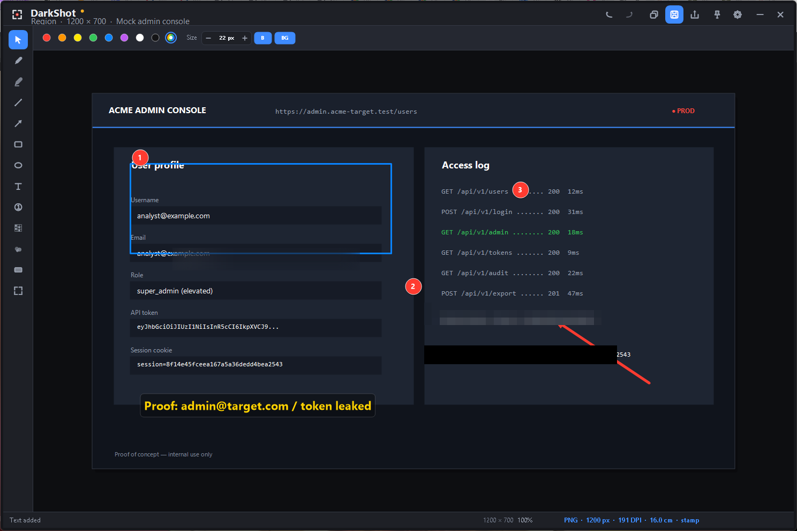
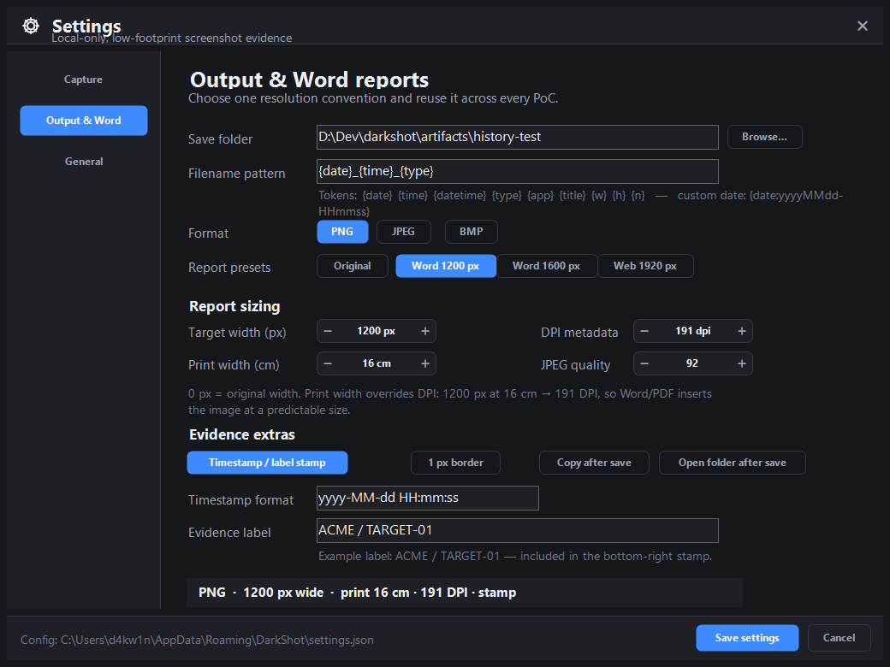
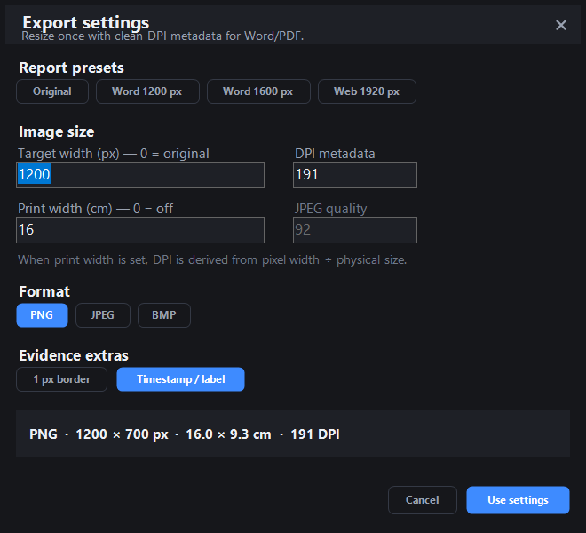
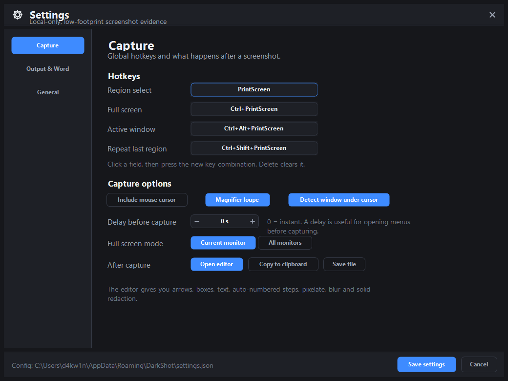
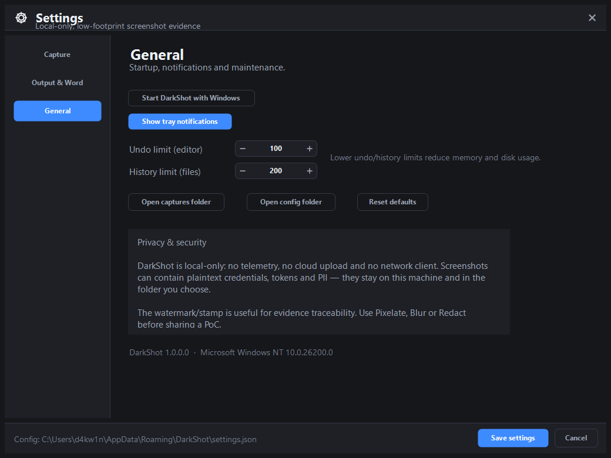
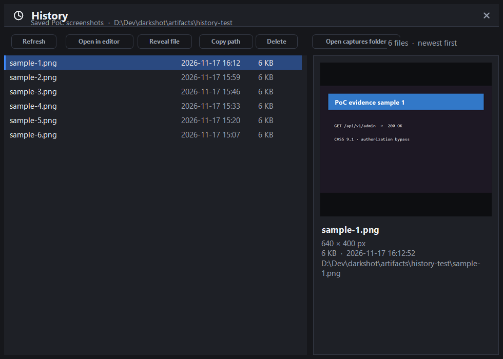
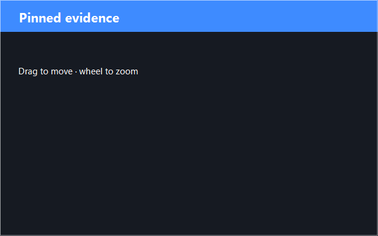

# DarkShot

**Chụp màn hình kiểu Lightshot dành cho pentest / red team / bug bounty — nhẹ, local-only, xuất ảnh chuẩn cho báo cáo Word.**

**GitHub:** <https://github.com/d4kw1n/darkshot>  
**Tải bản build:** <https://github.com/d4kw1n/darkshot/releases/latest>



DarkShot là ứng dụng Windows native (WinForms + GDI+, **không** Electron/WebView2, **không** package bên thứ ba). Mục tiêu: chụp PoC nhanh, đánh dấu bằng chứng rõ ràng, che dữ liệu nhạy cảm và xuất ảnh đúng độ phân giải/DPI để dán vào báo cáo Word mà không bị mờ.

---

## Vì sao DarkShot?

- **Nhẹ thật sự:** idle ~**49.1 MB** working set, **0% CPU**, khởi động ~**290 ms**; bản framework-dependent chỉ **0.6 MB**.
- **Tập trung PoC:** step badge tự tăng (1, 2, 3…), mũi tên, box, text, highlighter, **pixelate / blur / redact**, timestamp + nhãn evidence.
- **Xuất Word có kiểm soát:** đặt **target width**, **DPI metadata**, hoặc **print width cm**; DPI được tính tự động (`DPI = px ÷ (cm / 2.54)`).
- **Local-only:** không telemetry, không cloud upload, không network client. Ảnh PoC có thể chứa token/PII nên mặc định không rời máy.
- **Automation:** CLI + single-instance named pipe để chụp từ script (không cần thao tác tay).

---

## Tính năng

### Chụp

- Chọn vùng với desktop đóng băng, làm mờ nền, **magnifier 8×**, tọa độ + mã màu.
- **Phát hiện cửa sổ dưới con trỏ** (DWM extended frame bounds) — click để chụp cửa sổ.
- Kéo / di chuyển / resize vùng chọn bằng 8 handle trước khi chụp.
- Toàn màn hình (màn hình hiện tại hoặc **tất cả màn hình**), cửa sổ đang active, **repeat last region**.
- Delay 0–60 giây; tùy chọn chụp kèm con trỏ chuột.
- Đa màn hình + **Per-Monitor-V2 DPI**; toạ độ âm được hỗ trợ.
- Action bar ngay sau khi chọn: **Edit / Copy / Save / Pin / Cancel**.

### Editor chú thích PoC

| Công cụ | Phím | Ghi chú |
|---|---|---|
| Select / move / resize | `V` | 8 handle cho shape, 2 endpoint cho line/arrow, Delete để xoá |
| Pen | `P` | Freehand, màu + độ dày |
| Highlighter | `H` | Nét trong mờ |
| Line / Arrow | `L` / `A` | Mũi tên chỉ đúng vị trí lỗi |
| Rectangle / Ellipse | `R` / `O` | Có tuỳ chọn Fill |
| Text | `T` | Click → gõ → **Ctrl+Enter** hoặc click ra ngoài; double-click text có sẵn để sửa |
| Step badge | `N` | Tự tăng số, ví dụ 1 → 2 → 3 |
| Pixelate | `M` | Che token/PII bằng các ô pixel |
| Blur | `B` | Làm mờ |
| Redact | `D` | Khối đặc, không thể đọc lại |
| Crop | `C` | Crop không phá huỷ; `Ctrl+Z` khôi phục |

- Undo/redo (`Ctrl+Z`, `Ctrl+Y`), zoom (Ctrl+wheel), pan (middle-drag hoặc Space+drag).
- **Pin to screen** (`Ctrl+P`): ảnh luôn nổi trên cùng, kéo để di chuyển, lăn chuột để zoom.
- Mở ảnh có sẵn (`Open image…`) hoặc dán ảnh từ clipboard vào editor.
- Cảnh báo lưu khi đóng editor nếu còn thay đổi.

### Xuất ảnh cho Word

- Width: **Original / 800 / 1000 / 1200 / 1600 / 1920 / custom**.
- DPI: 96 / 120 / 150 / 192 / 220 / 300 / custom.
- **Print width (cm)**: khi đặt, DPI được suy ra từ pixel width để kích thước trên Word/PDF ổn định.
- Preset nhanh:
  - **Word 1200 px** — width 1200 px + print width 16 cm → **191 DPI**.
  - **Word 1600 px** — width 1600 px + print width 16 cm → **254 DPI**.
  - **Web 1920 px** — width 1920 px, 96 DPI.
  - **Original** — giữ nguyên kích thước gốc, 96 DPI.
- PNG (lossless) / JPEG (quality 10–100) / BMP.
- Tuỳ chọn **timestamp / evidence label** ở góc dưới-phải, viền 1 px.
- Quick Save với filename pattern + folder; Save As; Copy to clipboard (bitmap + PNG flavour để dán vào Word).
- Tự copy sau khi lưu và/hoặc mở folder sau khi lưu (tuỳ chọn).

Công thức:

```text
DPI hiệu dụng = pixel_width / (print_width_cm / 2.54)
print_width_cm = pixel_width / DPI * 2.54
```

Ví dụ đã kiểm chứng: **1200 × 675 px @ 191 DPI ≈ 15.96 × 8.98 cm**.

### Quản lý & tự động hoá

- Tray app, single instance, command pipe.
- Global hotkeys cấu hình được, phát hiện trùng/không đăng ký được.
- **History** duyệt ảnh đã lưu: preview, mở lại trong editor, reveal file, copy path, xoá vào Recycle Bin.
- Settings: Capture / Output & Word / General.
- Start with Windows; thông báo tray.
- CLI + `--rect`, `--output`, `--copy`, `--no-editor`, `--delay`, `--width`, `--dpi`, `--print-width`, `--format`.
- Config portable: đặt file rỗng `portable.txt` cạnh `DarkShot.exe` → config nằm trong `data\`.

---

## Cài đặt

### Bản đã publish

Tải zip từ [GitHub Releases](https://github.com/d4kw1n/darkshot/releases/latest), giải nén và chạy:

```text
DarkShot\DarkShot.exe
```

Yêu cầu: **Windows 10/11 x64** + **.NET Desktop Runtime 10 (x64)**.
Tải runtime: <https://dotnet.microsoft.com/download/dotnet/10.0>

### Build từ source

Yêu cầu .NET SDK 10.

```powershell
git clone https://github.com/d4kw1n/darkshot.git
cd darkshot
dotnet build .\DarkShot.slnx -c Release
powershell -ExecutionPolicy Bypass -File .\build.ps1
```

`build.ps1` tạo bản framework-dependent (~0.6 MB) trong `dist\DarkShot`.

Bản self-contained/portable (không cần cài .NET, file lớn hơn nhiều):

```powershell
powershell -ExecutionPolicy Bypass -File .\build.ps1 -SelfContained
```

> WinForms không hỗ trợ trimming/NativeAOT; bản self-contained sẽ đi kèm .NET runtime. Bản framework-dependent là lựa chọn nhẹ nhất.

---

## Dùng nhanh

1. Chạy `DarkShot.exe`. App nằm ở tray.
2. Nhấn **PrintScreen** → kéo chọn vùng.
3. Thả chuột → chọn **Edit** (hoặc nhấn Enter).
4. Chú thích: đánh số bước, mũi tên, box, che token.
5. Chọn preset **Word 1200 px** ở thanh dưới editor (hoặc mở **Export settings**).
6. **Ctrl+S** để lưu, hoặc **Ctrl+C** rồi dán vào Word.

Mặc định ảnh lưu vào `Pictures\DarkShot`; tên file theo pattern ngày giờ + loại chụp.





---

## Phím tắt

### Global (đổi trong Settings)

| Hành động | Mặc định |
|---|---|
| Chọn vùng | `PrintScreen` |
| Toàn màn hình hiện tại | `Ctrl+PrintScreen` |
| Cửa sổ đang active | `Ctrl+Alt+PrintScreen` |
| Repeat vùng trước | `Ctrl+Shift+PrintScreen` |

Có thể dùng `Ctrl`, `Alt`, `Shift` + phím. Nếu PrintScreen bị Windows/Snipping Tool chiếm, đổi sang `Ctrl+Shift+X` hoặc tổ hợp khác.

### Overlay chụp

| Thao tác | Phím / chuột |
|---|---|
| Chọn vùng | Kéo chuột trái |
| Chụp cửa sổ dưới con trỏ | Click (không kéo) |
| Mở editor | `Enter` / double-click vùng chọn / nút Edit |
| Copy | `Ctrl+C` |
| Lưu | `Ctrl+S` |
| Pin | `Ctrl+P` |
| Bật/tắt magnifier | `M` |
| Chọn tất cả màn hình | `Ctrl+A` |
| Chọn màn hình hiện tại | `Ctrl+Shift+A` |
| Di chuyển vùng chọn 1 px | Phím mũi tên (`Shift` = 10 px) |
| Huỷ | `Esc` / chuột phải / nút X |

### Editor

| Thao tác | Phím |
|---|---|
| Undo / Redo | `Ctrl+Z` / `Ctrl+Y` |
| Copy | `Ctrl+C` |
| Quick Save / Save As | `Ctrl+S` / `Ctrl+Shift+S` |
| Pin to screen | `Ctrl+P` |
| Duplicate / Delete | `Ctrl+D` / `Delete` |
| Fit / 100% | `Ctrl+0` / `Ctrl+1` |
| Zoom | `Ctrl+ +` / `Ctrl+ -` / `Ctrl+wheel` |
| Pan | Middle-drag / `Space`+drag |
| Công cụ | `V P H L A R O T N M B D C` |
| Nudge annotation | Phím mũi tên (`Shift` = 10 px) |
| Huỷ chọn / huỷ crop / đóng text | `Esc` |
| Đóng editor | `Ctrl+W` / nút X |

---

## Xuất ảnh cho báo cáo Word — cách chọn

Mở **Export settings** ở editor (hoặc Settings → **Output & Word**):

| Mục tiêu | Target width | Print width | DPI hiệu dụng | Ghi chú |
|---|---:|---:|---:|---|
| Word, cột đôi | 1200 px | 16 cm | ~191 | Preset **Word 1200 px** |
| Word, cột đôi, nét hơn | 1600 px | 16 cm | ~254 | Preset **Word 1600 px** |
| Word, ảnh nhỏ | 800 px | 10 cm | ~203 | Custom |
| Web / chat | 1920 px | off | 96 | Preset **Web 1920 px** |
| Giữ nguyên pixel gốc | 0 (Original) | off | 96 | Có thể chỉnh DPI riêng |

- Nếu chỉ cần ảnh nét, chọn **target width**; nếu cần đúng kích thước vật lý khi in/Word, đặt **print width cm**.
- Word/PDF dùng DPI metadata để quy đổi; nếu Word vẫn hiển thị khác, kích thước pixel vẫn giữ nguyên và ảnh vẫn nét.
- Nên dùng **PNG** cho chữ/UI; **JPEG** khi cần dung lượng nhỏ hơn.

### Quy trình PoC gợi ý

1. Chụp bằng PrintScreen.
2. Đánh **Step 1/2/3** theo thứ tự khai thác.
3. Dùng **Arrow/Box** khoanh vùng request/response, ID, role.
4. Che **Cookie/Token/PII** bằng **Redact** (an toàn nhất) hoặc **Pixelate**; **Blur** chỉ là che mờ thị giác.
5. Bật **Timestamp / label** với nhãn case (`ACME / TARGET-01`).
6. Chọn preset **Word 1200 px** → `Ctrl+C` → dán vào Word; hoặc `Ctrl+S`.

> **Lưu ý bảo mật:** luôn kiểm tra lại ảnh đã xuất. Blur không phải mã hoá; với dữ liệu nhạy cảm, dùng **Redact** hoặc **Pixelate** và kiểm tra pixel sau khi lưu.

---

## CLI & automation

```powershell
# Chụp vùng cố định, không mở UI, lưu file 800 px rộng, 16 cm print width
DarkShot.exe --rect 0,0,1280,720 --no-editor --output C:\PoC\login.png `
  --width 800 --print-width 16 --format png --silent

# Chụp toàn màn hình hiện tại (màn hình đang có con trỏ) và copy
DarkShot.exe --full --copy --no-editor --silent

# Chụp cửa sổ active
DarkShot.exe --window --no-editor --output C:\PoC\window.png --silent

# Delay 3 giây rồi chụp đúng vùng trước đó
DarkShot.exe --repeat --delay 3 --no-editor --output C:\PoC\repeat.png --silent

# Mở ảnh có sẵn trong editor
DarkShot.exe --open C:\PoC\finding.png

# Mở Settings / History
DarkShot.exe --settings
DarkShot.exe --history

# Thoát instance đang chạy
DarkShot.exe --quit
```

Xem đầy đủ: `DarkShot.exe --help`.

`--output` có thể là file hoặc thư mục; nếu là thư mục, DarkShot tự đặt tên theo pattern. Toạ độ `--rect` là **pixel vật lý** trên virtual desktop (hỗ trợ số âm với màn hình bên trái).

---

## Cấu hình & dữ liệu

- Config: `%AppData%\DarkShot\settings.json`
- Log: `%AppData%\DarkShot\logs\darkshot.log` (chỉ lỗi/đường dẫn, **không** chứa nội dung ảnh)
- Captures mặc định: `Pictures\DarkShot`
- **Portable:** tạo file rỗng `portable.txt` cạnh `DarkShot.exe` → config trong `data\` cạnh app.

Filename tokens:

```text
{date} {time} {datetime} {type} {app} {title} {w} {h} {n}
{date:yyyyMMdd-HHmmss} {time:HHmmss}
```

Ví dụ: `{date}_{time}_{type}_{app}` → `2026-11-17_15-30-00_region_chrome.png`.

---

## Settings





- **Capture:** global hotkeys (record trực tiếp bằng cách bấm tổ hợp), delay, magnifier, window detection, after-capture action.
- **Output & Word:** folder, filename pattern, format, report presets, target width/DPI/print width, timestamp/evidence label, viền, copy/open-folder sau khi lưu.
- **General:** start with Windows, tray notifications, giới hạn undo/history, mở config/captures folder, reset defaults.

## History



- Quét ảnh trong save folder, mới nhất trước.
- Double-click hoặc **Open in editor** để mở lại.
- **Reveal file**, **Copy path**, **Delete** (Recycle Bin), **Open captures folder**.
- Preview + kích thước + thời gian + đường dẫn.

---

## Pin to screen



Dùng khi cần đối chiếu ảnh PoC với ứng dụng đang thao tác. Ảnh nổi trên cùng, kéo để di chuyển, lăn chuột zoom, chuột phải để Copy / Save / Close.

---

## Hiệu năng

Đo trên bản Release đã publish (Ryzen 7 4800H, 23.4 GB RAM, Windows 11 26200):

| Chỉ số | Kết quả |
|---|---:|
| Kích thước bản framework-dependent | **0.6 MB** |
| Khởi động → tray ready | **290 ms** |
| Idle working set / private | **49.1 MB / 11.8 MB** |
| Idle CPU (10 s) | **0 %** |
| Editor working set / private | **71.1 MB / 20.4 MB** |
| CLI capture 640×400 → 800px PNG | **290 ms** trung bình |

Chi tiết + cách đo: [docs/PERFORMANCE.md](docs/PERFORMANCE.md).

---

## Bảo mật & riêng tư

- **Không có network code** trong v1: không telemetry, không upload, không auto-update.
- Chạy `asInvoker` (không cần admin).
- Log chỉ ghi đường dẫn/lỗi; không ghi nội dung ảnh.
- Clipboard và file lưu là local; hãy tự bảo vệ thư mục PoC.
- Không chụp được **UAC secure desktop** và một số nội dung DRM/protected — đây là giới hạn của Windows, không phải bug.
- Ảnh chụp có thể chứa secrets. **Redact/Pixelate** trước khi chia sẻ; kiểm tra file đã xuất.
- Không upload cloud là **lựa chọn có chủ đích** cho môi trường pentest.

---

## Giới hạn có chủ đích

- Không scrolling capture, screen recording/GIF, OCR, cloud share/upload trong v1.
- Chỉ Windows 10/11 x64.
- Blur là hiệu ứng thị giác, không đảm bảo che dữ liệu tuyệt đối; dùng Redact/Pixelate cho secrets.
- Bản framework-dependent cần .NET Desktop Runtime 10; bản self-contained nặng hơn.
- UI tiếng Anh (tài liệu tiếng Việt); có thể bổ sung localization sau.

---

## Kiểm thử

```powershell
# 102 unit assertions
.\tests\DarkShot.Tests\bin\Debug\net10.0-windows\DarkShot.Tests.exe tests

# Editor: 9 annotations, undo/redo, crop, save 1200x700 @191 DPI
.\tests\DarkShot.Tests\bin\Debug\net10.0-windows\DarkShot.Tests.exe editor

# Overlay: chọn vùng, action Edit
.\tests\DarkShot.Tests\bin\Debug\net10.0-windows\DarkShot.Tests.exe overlay-auto

# Settings / History / Pin screenshot test
.\tests\DarkShot.Tests\bin\Debug\net10.0-windows\DarkShot.Tests.exe ui
```

Kết quả chi tiết: [docs/TESTING.md](docs/TESTING.md).

---

## Cấu trúc dự án

```text
src/DarkShot/
  Core/           settings, hotkeys, GDI capture, CLI, export, clipboard, IPC
  Annotations/    annotation model, hit-testing, undo, GDI+ renderer
  UI/
    CaptureOverlayForm.cs   frozen desktop, magnifier, window detection, toolbar
    Editor/                  EditorForm, EditorCanvas, export dialog
    SettingsForm.cs          Capture / Output & Word / General
    HistoryForm.cs           saved capture browser
    PinForm.cs               always-on-top reference window
    TrayAppContext.cs        tray, hotkeys, capture orchestration
tests/DarkShot.Tests/        unit + UI/integration test harness
tools/                       icon generator, performance measurement
docs/                        research, performance, testing, images
```

Thiết kế chi tiết & so sánh với Lightshot/ShareX/Greenshot/Flameshot/Snipaste: [docs/RESEARCH.md](docs/RESEARCH.md).

---

## Troubleshooting

**PrintScreen không mở DarkShot**
- Windows 11 có thể dành PrintScreen cho Snipping Tool. Vào Settings → **Capture** → đổi hotkey (ví dụ `Ctrl+Shift+X`), hoặc tắt “Use the Print screen key to open Snipping Tool” trong Windows.
- Kiểm tra DarkShot còn chạy trong tray; nếu hotkey bị app khác chiếm, app sẽ hiện balloon cảnh báo và ghi log.

**Không chạy được file exe**
- Cài .NET Desktop Runtime 10 x64, hoặc dùng bản self-contained.
- SmartScreen có thể cảnh báo vì exe chưa ký số → *More info → Run anyway*.

**Dán vào Word bị mờ**
- Chọn preset Word 1200/1600 px trước khi Copy.
- Không phóng to ảnh trong Word quá nhiều; giữ đúng kích thước/DPI.
- Nếu Word không nhận DPI, đặt lại kích thước ảnh trong Word; pixel vẫn giữ nguyên.

**Clipboard busy**
- Đóng app đang giữ clipboard hoặc thử `Ctrl+C` lại; DarkShot có retry.

**Ảnh lớn hơn màn hình logic**
- App chạy Per-Monitor-V2, chụp pixel vật lý. Ở scaling 125%, ảnh 1920×1080 vẫn là 1920×1080, trong khi Windows hiển thị “1536×864” cho app DPI-unaware. Đây là hành vi đúng.

**Không có tray icon**
- Kiểm tra vùng tray ẩn (mũi tên ^). Chạy lại app; single-instance sẽ báo nếu đã có instance.

---

## Ghi chú

Ảnh trong `docs/images` là dữ liệu **giả lập** (mock admin console, sample history) — không chứa dữ liệu người dùng.

DarkShot được xây dựng cho mục đích kiểm thử bảo mật có uỷ quyền. Chỉ chụp và chia sẻ dữ liệu khi bạn có quyền.
